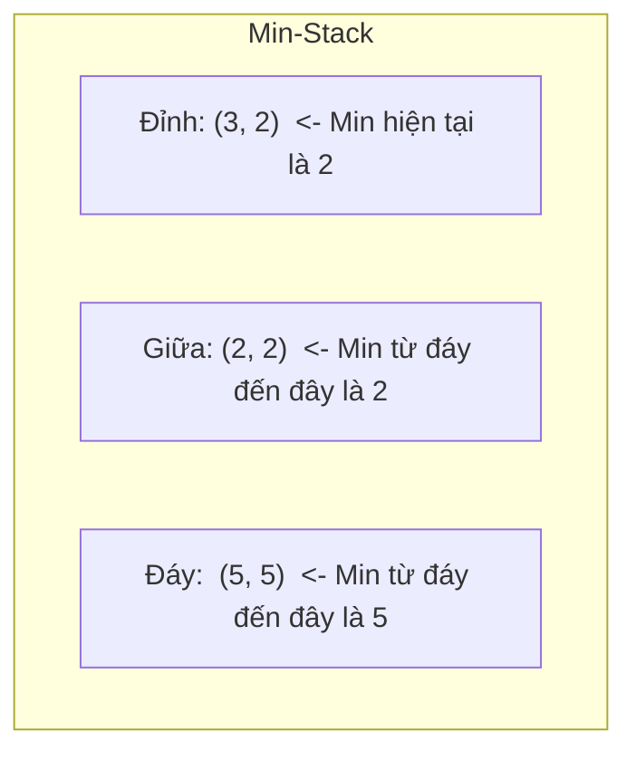
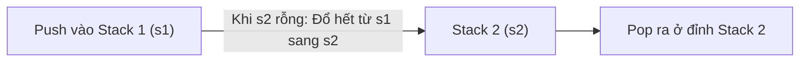

> *"Bạn có một ngăn xếp hoặc hàng đợi liên tục thêm vào và bốc ra hàng trăm nghìn phần tử. Cứ mỗi bước, đề bài lại hỏi: 'Này, phần tử nhỏ nhất hiện tại là bao nhiêu?'"*

Cách ngây thơ nhất: Mỗi lần hỏi lại chạy vòng lặp duyệt hết mảng để tìm min $\to$ Tốn $O(n)$ thời gian, với $n = 10^5$ là ăn ngay án phạt quá thời gian (TLE).  
Dùng cấu trúc dữ liệu xịn như `std::multiset` hay `std::priority_queue`? Mất $O(\log n)$ cho mỗi thao tác, và tệ hơn là `priority_queue` không cho phép xóa phần tử bất kỳ ở đầu hàng đợi.

Vậy có cách nào để **thêm phần tử, xóa phần tử và hỏi phần tử nhỏ nhất (Get Min) TẤT CẢ đều chạy trong $O(1)$** không?

Câu trả lời là **CÓ**! Và cách làm thì đơn giản và tự nhiên đến mức bạn sẽ phải bất ngờ.

---

## 1. Cải tiến Ngăn xếp: Min-Stack trong một nốt nhạc

Ngăn xếp (Stack) hoạt động theo nguyên tắc **LIFO (Last In, First Out - Vào sau ra trước)**: Ta chỉ thêm và lấy phần tử ra ở đúng một đầu (đỉnh stack).

### Ý tưởng cốt lõi: Mang theo "kỷ lục"
Thay vì chỉ lưu giá trị đơn thuần, ta bắt mỗi phần tử khi bước vào stack phải mang theo một người bạn đồng hành: **Giá trị nhỏ nhất tính từ đáy stack lên đến chính nó**.

Ta dùng `std::pair<int, int>`:
- `first`: Giá trị thực tế của phần tử.
- `second`: Giá trị nhỏ nhất hiện tại trong toàn bộ stack.



### Cách hoạt động:
1. **Thêm phần tử `x` (Push):**  
   So sánh `x` với kỷ lục min của phần tử đứng ngay dưới nó:
   $$\text{new\_record} = \min(x, \text{old\_record})$$
   *(Trong đó kỷ lục mới là giá trị nhỏ hơn giữa $x$ và kỷ lục cũ trên đỉnh stack).*
   Đẩy cặp `{x, kỷ lục mới}` vào stack.

2. **Lấy min (Get Min):**  
   Chỉ cần nhìn vào `st.top().second`. Đúng **1 phép tính** $O(1)$!

3. **Xóa phần tử (Pop):**  
   Chỉ cần `st.pop()`. Phần tử trên đỉnh biến mất, kỷ lục của phần tử ngay bên dưới tự động lộ ra nguyên vẹn như chưa từng có chuyện gì xảy ra!

### Code C++ siêu gọn:
```cpp
#include <stack>
#include <algorithm>

struct MinStack {
    std::stack<std::pair<int, int>> st;

    void push(int new_elem) {
        int new_min = st.empty() ? new_elem : std::min(new_elem, st.top().second);
        st.push({new_elem, new_min});
    }

    void pop() {
        if (!st.empty()) st.pop();
    }

    int top() {
        return st.top().first;
    }

    int get_min() {
        return st.top().second; // O(1) thần tốc
    }

    bool empty() {
        return st.empty();
    }
};
```

---

## 2. Thử thách thực sự: Min-Queue (Hàng đợi tìm Min)

Stack thì dễ rồi, nhưng **Hàng đợi (Queue)** thì vào một đầu (đuôi) và ra ở đầu kia (đầu hàng - FIFO).  
Khi phần tử nhỏ nhất nằm ở đầu hàng bị xóa đi, làm sao ta biết phần tử nào còn lại trong hàng đợi sẽ lên ngôi vị nhỏ nhất tiếp theo mà không phải tìm lại từ đầu?

Dưới đây là 2 cách tiếp cận tuyệt vời nhất:

---

### Phương pháp 1: Hàng đợi đơn điệu (Monotonic Queue) với `std::deque`

Phương pháp này dựa trên một triết lý đời thường rất vui:
> *"Nếu có một người vừa **TRẺ HƠN** bạn (vào hàng đợi sau bạn), mà lại còn **GIỎI HƠN** bạn (giá trị nhỏ hơn bạn), thì bạn sẽ không bao giờ có cơ hội tỏa sáng (không bao giờ có thể trở thành Min)!"*

### Quy tắc vận hành:
Ta dùng một hàng đợi hai đầu (`std::deque`):
1. **Thêm phần tử mới `x` vào đuôi (Push):**  
   Nhìn vào đuôi hàng đợi: Nếu phần tử ở đuôi mà **lớn hơn hoặc bằng `x`**, hãy mạnh dạn xóa nó khỏi đuôi! Vì sao? Vì nó vào trước $x$ (sẽ bị xóa sớm hơn $x$) mà giá trị lại lớn hơn $x$, nên nó vĩnh viễn không bao giờ có thể là giá trị nhỏ nhất được nữa.  
   Xóa cho đến khi đuôi nhỏ hơn $x$, rồi đẩy $x$ vào.  
   $\implies$ **Hàng đợi luôn được duy trì tăng dần từ đầu đến đuôi!**

2. **Lấy Min:**  
   Phần tử nhỏ nhất luôn luôn nằm chễm chệ ở ngay đầu hàng đợi (`q.front()`) $\implies$ $O(1)$!

3. **Xóa phần tử ở đầu (Pop):**  
   Nếu phần tử cần xóa đúng bằng phần tử ở `q.front()`, ta `q.pop_front()`. Còn nếu không bằng (nghĩa là nó đã bị đá văng từ trước lúc ta push phần tử nhỏ hơn vào), ta không cần làm gì cả!

```cpp
#include <deque>

struct MinQueueMonotonic {
    std::deque<int> q;

    void push(int x) {
        // Đuổi tất cả những đứa lớn hơn x ra khỏi đuôi
        while (!q.empty() && q.back() > x) {
            q.pop_back();
        }
        q.push_back(x);
    }

    void pop(int val_to_remove) {
        if (!q.empty() && q.front() == val_to_remove) {
            q.pop_front();
        }
    }

    int get_min() {
        return q.front();
    }
};
```

*Độ phức tạp:* Mặc dù lệnh `push` có vòng lặp `while`, nhưng mỗi phần tử chỉ được đẩy vào deque đúng 1 lần và bị đuổi ra tối đa 1 lần. Trung bình cộng (amortized) qua $n$ thao tác, mỗi thao tác chỉ tốn đúng **$O(1)$**!

---

### Phương pháp 2: Mô phỏng Queue bằng 2 Min-Stack

Nếu bạn không muốn quan tâm đến giá trị khi pop, hoặc muốn lưu trọn vẹn toàn bộ các phần tử thì sao?  
Hãy nhớ lại bài học vỡ lòng: **Ta có thể làm một Queue bằng 2 Stack!**



- Ta dùng hai `MinStack` ở Phần 1: `s1` (chuyên nhận phần tử vào) và `s2` (chuyên lấy phần tử ra).
- Khi thêm: `push` vào `s1`.
- Khi xóa: Lấy ra từ `s2`. Nếu `s2` đang rỗng, ta trút toàn bộ phần tử từ `s1` sang `s2` (thao tác trút này sẽ đảo ngược thứ tự các phần tử, biến LIFO thành đúng chuẩn FIFO!).
- **Lấy Min:** Min của cả hàng đợi chính là:
  $$\min(\text{min}(s1), \text{min}(s2))$$
  *(Lấy giá trị nhỏ hơn giữa phần tử nhỏ nhất của $s1$ và phần tử nhỏ nhất của $s2$).*

```cpp
struct MinQueueTwoStacks {
    MinStack s1, s2;

    void push(int x) {
        s1.push(x);
    }

    void pop() {
        if (s2.empty()) {
            while (!s1.empty()) {
                int val = s1.top();
                s1.pop();
                s2.push(val);
            }
        }
        s2.pop();
    }

    int get_min() {
        if (s1.empty()) return s2.get_min();
        if (s2.empty()) return s1.get_min();
        return std::min(s1.get_min(), s2.get_min());
    }
};
```

Mỗi phần tử chỉ vào `s1` 1 lần, chuyển sang `s2` 1 lần, và ra khỏi `s2` 1 lần $\implies$ Độ phức tạp trung bình vẫn là **$O(1)$**!

---

## 3. Ứng dụng kinh điển: Cửa sổ trượt (Sliding Window Minimum)

Hãy xem sức mạnh của Min-Queue khi áp dụng vào một bài toán thực tế:

**Bài toán:** Cho mảng $A$ gồm $N$ phần tử và số nguyên $K \le N$. Hãy tìm giá trị nhỏ nhất của tất cả các đoạn con liên tiếp có độ dài đúng bằng $K$:
$$\min(A[0 \dots K-1]), \quad \min(A[1 \dots K]), \quad \min(A[2 \dots K+1]), \quad \dots$$

### Giải thuật với Min-Queue trong $O(N)$:
1. Nạp $K$ phần tử đầu tiên vào Min-Queue.
2. In ra `get_min()` của cửa sổ đầu tiên.
3. Với mỗi bước tiếp theo:
   - Thêm phần tử mới ở bên phải vào Min-Queue (`push(A[i])`).
   - Xóa phần tử vừa trượt ra khỏi cửa sổ ở bên trái (`pop(A[i - K])`).
   - In ra `get_min()`.

Toàn bộ thuật toán duyệt qua mảng đúng $1$ lần duy nhất: **$O(N)$ thời gian và $O(K)$ bộ nhớ**!

### Code mẫu hoàn chỉnh giải bài toán Sliding Window:
```cpp
#include <iostream>
#include <vector>
#include <deque>

std::vector<int> sliding_window_minimum(const std::vector<int>& a, int k) {
    std::vector<int> result;
    std::deque<int> dq; // Lưu chỉ số (index) của các phần tử

    for (int i = 0; i < (int)a.size(); i++) {
        // 1. Loại bỏ các phần tử đã trượt ra ngoài cửa sổ [i - k + 1, i]
        while (!dq.empty() && dq.front() <= i - k) {
            dq.pop_front();
        }

        // 2. Loại bỏ các phần tử ở đuôi lớn hơn hoặc bằng a[i]
        while (!dq.empty() && a[dq.back()] >= a[i]) {
            dq.pop_back();
        }

        // 3. Đẩy chỉ số của a[i] vào đuôi
        dq.push_back(i);

        // 4. Khi cửa sổ đã đủ kích thước k, ghi nhận kết quả
        if (i >= k - 1) {
            result.push_back(a[dq.front()]);
        }
    }
    return result;
}
```

---

## 4. Bảng so sánh các phương pháp

| Cấu trúc | Thêm (Push) | Xóa (Pop) | Lấy Min (Get Min) | Bộ nhớ | Ưu điểm nổi bật |
| :--- | :--- | :--- | :--- | :--- | :--- |
| **Min-Stack** | $O(1)$ | $O(1)$ | $O(1)$ | $O(N)$ | Cực dễ cài đặt, không bao giờ lỗi. |
| **Min-Queue (Deque đơn điệu)** | $O(1)$* | $O(1)$* | $O(1)$ | $O(K)$ | Nhanh nhất, gọn nhất cho bài toán Cửa sổ trượt. |
| **Min-Queue (2 Stack)** | $O(1)$* | $O(1)$* | $O(1)$ | $O(N)$ | Giữ nguyên mọi phần tử, mở rộng được cho cả phép tính GCD trên cửa sổ trượt! |

*(\* là độ phức tạp trung bình amortized).*

---

## 5. Bài tập thực hành có link trực tiếp

Luyện tập ngay để biến kỹ thuật này thành phản xạ tự nhiên của bạn:

1. [CSES - Sliding Window Minimum](https://cses.fi/problemset/task/3221): Bài toán chuẩn mực đo tốc độ cài đặt Min-Queue.
2. [HackerRank - Queries with Fixed Length](https://www.hackerrank.com/challenges/queries-with-fixed-length/problem): Bài toán phối hợp cửa sổ trượt độ dài $K$.
3. [CodeChef - Binary Land (BINLAND)](https://www.codechef.com/MAY20A/problems/BINLAND): Ứng dụng đỉnh cao của kỹ thuật mô phỏng Queue bằng 2 Stack.

---

## Lời kết

Việc tìm phần tử nhỏ nhất không nhất thiết phải dùng đến những cây tìm kiếm nhị phân hay cây phân đoạn (Segment Tree) phức tạp. Chỉ với một chút khéo léo trong cách lưu trữ "kỷ lục" của Stack hay triết lý "loại bỏ kẻ yếu hơn" của Hàng đợi đơn điệu, bạn đã có ngay một giải thuật $O(1)$ nhanh như chớp. Chúc các bạn code mượt mà và tận hưởng niềm vui khi bài làm xanh rực rỡ!
