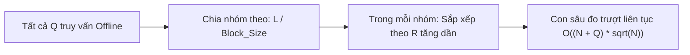

> *"Trong các kỳ thi lập trình, đôi khi bạn gặp những bài toán hóc búa đến mức các cây xịn sò như Segment Tree hay Fenwick Tree cũng phải bó tay chịu trói (ví dụ: đếm số phần tử xuất hiện nhiều nhất, đếm số giá trị phân biệt trên đoạn). Vào những lúc bế tắc nhất, một ý tưởng mộc mạc từ toán học lớp 7 lại xuất hiện và cứu vớt tất cả: **Căn bậc hai ($\sqrt{N}$)**."*

Kỹ thuật **Chia căn (Sqrt Decomposition)** và người anh em song sinh **Thuật toán Mo (Mo's Algorithm)** chính là minh chứng hùng hồn nhất cho câu nói: *"Không cần dùng dao mổ trâu để giết gà"*.

Hôm nay, hãy cùng mình biến kỹ thuật tưởng như cao siêu này thành hình ảnh **đóng hộp kẹo** và **chú sâu đo** dễ hiểu đến mức bạn sẽ phải thốt lên: *"Trời ơi, tại sao mình không biết đến nó sớm hơn?!"*

---

## 1. Ẩn dụ đóng hộp: Chia để trị kiểu nông dân

Tưởng tượng bạn có $10.000$ viên kẹo xếp thành một hàng dài trên bàn, đánh số từ $0$ đến $9.999$.

Mỗi phút, khách hàng lại bước vào hỏi một câu: *"Hãy tính tổng giá trị của các viên kẹo từ viên số $L$ đến viên số $R$!"*.
- Nếu bạn đứng đếm từng viên một: Gặp đoạn dài $9.000$ viên, bạn đếm mất $9.000$ bước $\implies$ Mất $O(N)$ thời gian, khách chờ lâu quá bỏ đi mất!

### Cách người thông minh làm:
Bạn mua sẵn những chiếc hộp giấy: **Mỗi hộp đóng vừa đúng $100$ viên kẹo** ($\sqrt{10.000} = 100$).
- Hộp 0: Chứa từ viên $0 \to 99$. Bạn tính sẵn tổng kẹo trong hộp này.
- Hộp 1: Chứa từ viên $100 \to 199$. Bạn tính sẵn tổng kẹo trong hộp này.
- $\dots$
- Hộp 99: Chứa từ viên $9.900 \to 9.999$.

```
Mảng kẹo:
[--- Hộp 0 ---] [--- Hộp 1 ---] ... [--- Hộp k ---] ... [--- Hộp 99 ---]
  (100 viên)      (100 viên)           (100 viên)          (100 viên)
```

Bây giờ, nếu khách hỏi đoạn $[150, 850]$:
1. **Các hộp nằm trọn ở giữa:** Bạn chỉ việc bê nguyên Hộp 2, Hộp 3, Hộp 4, Hộp 5, Hộp 6, Hộp 7. Có tối đa $100$ hộp $\implies$ Cộng $6$ phép tính là xong cả nghìn viên kẹo!
2. **Hai đầu mút lẻ loi (gọi là 2 cái "đuôi" - tails):**
   - Đuôi trái: Từ viên $150$ đến $199$ (thuộc Hộp 1): Đếm lẻ từng viên (chỉ mất $50$ bước).
   - Đuôi phải: Từ viên $800$ đến $850$ (thuộc Hộp 8): Đếm lẻ từng viên (chỉ mất $51$ bước).

**Tổng số phép tính:** $50 \text{ (left tail)} + 6 \text{ (blocks)} + 51 \text{ (right tail)} \approx 107$ phép tính!  
*(Gồm 50 viên lẻ đuôi trái + 6 hộp ở giữa + 51 viên lẻ đuôi phải).*  
So với $700$ phép tính đếm từng viên ban đầu, bạn đã nhanh hơn gấp nhiều lần.

Đó chính là độ phức tạp **$O(\sqrt{N})$**!

---

## 2. Công thức và Cài đặt C++ cơ bản

Với mảng có $N$ phần tử:
- Ta chọn kích thước mỗi khối là $S = \lceil \sqrt{N} \rceil$.
- Khối $k$ sẽ quản lý các phần tử từ chỉ số $k \cdot S$ đến $(k + 1) \cdot S - 1$.
- Mảng `b[k]` lưu tổng của khối thứ $k$.

### Code C++ tính tổng đoạn $[L, R]$ trong $O(\sqrt{N})$:

```cpp
#include <iostream>
#include <vector>
#include <cmath>

struct SqrtDecomposition {
    int n, block_size;
    std::vector<long long> a;
    std::vector<long long> b; // b[k] lưu tổng của khối k

    SqrtDecomposition(const std::vector<long long>& input) {
        a = input;
        n = a.size();
        block_size = std::sqrt(n) + 1;
        b.assign(n / block_size + 1, 0);

        for (int i = 0; i < n; i++) {
            b[i / block_size] += a[i];
        }
    }

    // Cập nhật giá trị tại vị trí idx trong O(1)
    void update(int idx, long long new_val) {
        int k = idx / block_size;
        b[k] += new_val - a[idx];
        a[idx] = new_val;
    }

    // Tính tổng đoạn [l, r] trong O(sqrt(n))
    long long query(int l, int r) {
        long long sum = 0;
        int cl = l / block_size;
        int cr = r / block_size;

        if (cl == cr) {
            // Trường hợp 1: Cả l và r nằm chung trong một khối
            for (int i = l; i <= r; i++) sum += a[i];
        } else {
            // Trường hợp 2: l và r nằm khác khối
            // 1. Đuôi bên trái (từ l đến hết khối cl)
            for (int i = l, end = (cl + 1) * block_size - 1; i <= end; i++) 
                sum += a[i];
            
            // 2. Các khối nằm trọn vẹn ở giữa
            for (int k = cl + 1; k < cr; k++) 
                sum += b[k];
            
            // 3. Đuôi bên phải (từ đầu khối cr đến r)
            for (int i = cr * block_size; i <= r; i++) 
                sum += a[i];
        }
        return sum;
    }
};
```

---

## 3. Thuật toán Mo: Con sâu đo đảo ngược cờ thế

Đến đây, nhiều bạn sẽ bảo: *"Nhưng tính tổng hay tìm Min/Max thì Segment Tree chạy mất $O(\log N)$ còn nhanh hơn $O(\sqrt{N})$, tội gì phải chia căn?"*

Đúng vậy! Sức mạnh hủy diệt thực sự của chia căn không nằm ở bài toán tính tổng, mà nằm ở **Thuật toán Mo (Mo's Algorithm)**.

### Bài toán khiến Segment Tree phải "khóc thét":
> Cho mảng $A$ có $N$ phần tử và $Q$ câu hỏi dạng:  
> *"Đoạn $[L, R]$ có bao nhiêu phần tử phân biệt?"* hoặc *"Phần tử nào xuất hiện nhiều lần nhất trong đoạn $[L, R]$?"*

Với bài này:
- Bạn không thể lấy kết quả của nửa trái gộp với nửa phải như Segment Tree được! Vì một số có thể xuất hiện ở cả hai bên, làm sao biết số nào trùng?
- Nhưng nếu ta có một cửa sổ $[L, R]$, việc **thêm 1 phần tử** vào cửa sổ hoặc **bỏ 1 phần tử** ra khỏi cửa sổ thì lại cực kỳ dễ và chỉ mất đúng **$O(1)$**!

### Ý tưởng con sâu đo:
Tưởng tượng ta có hai con trỏ `cur_l` và `cur_r`.  
Để chuyển từ đoạn cũ $[cur\_l, cur\_r]$ sang đoạn mới $[q.l, q.r]$, ta chỉ cần cho con trỏ bò từng bước:
- Mở rộng sang phải: `add(++cur_r)`
- Co hẹp bên trái: `remove(cur_l++)`

Nhưng nếu các câu hỏi cứ nhảy lung tung (câu 1 hỏi $[1, 2]$, câu 2 hỏi $[1, 10^5]$, câu 3 lại hỏi $[2, 3]$), con trỏ chạy qua chạy lại sẽ mất $O(N \cdot Q)$!

### Bí thuật của Mo: Sắp xếp lại thứ tự trả lời câu hỏi (Offline)
Mo nhận ra rằng: Nếu đề bài cho phép đọc hết $Q$ câu hỏi trước rồi mới trả lời, ta có thể **sắp xếp lại các câu hỏi** theo một thứ tự di chuyển tối ưu nhất!

**Quy tắc sắp xếp của Mo:**
1. Chia mảng thành các khối kích thước $\sqrt{N}$.
2. Nhóm các câu hỏi có $L$ nằm cùng một khối lại với nhau.
3. Trong cùng một khối của $L$, ta sắp xếp các câu hỏi theo $R$ tăng dần!



### Tại sao con sâu đo lại chạy siêu nhanh?
- Với tất cả các câu hỏi có $L$ nằm trong cùng một khối: $R$ luôn đi thẳng một mạch từ trái sang phải mà không bao giờ quay đầu $\implies$ $R$ chỉ di chuyển tối đa $N$ bước cho mỗi khối! Có $\sqrt{N}$ khối $\implies$ Tổng số bước của $R$ là $N \sqrt{N}$.
- Đầu mút $L$ chỉ lúc lắc qua lại bên trong một khối có độ rộng $\sqrt{N} \implies$ Mỗi câu hỏi $L$ chỉ nhảy tối đa $\sqrt{N}$ bước $\implies$ Tổng số bước của $L$ là $Q \sqrt{N}$.

Tổng thời gian cho cả $Q$ câu hỏi là:
$$O((N + Q) \sqrt{N})$$
Với $N, Q = 2 \cdot 10^5$, thuật toán chạy vèo vèo trong khoảng $0.5$ giây!

---

## 4. Cài đặt C++ chuẩn mực cho Thuật toán Mo

Dưới đây là template giải bài toán kinh điển: **Đếm số lượng phần tử phân biệt trên đoạn $[L, R]$**:

```cpp
#include <iostream>
#include <vector>
#include <cmath>
#include <algorithm>

const int BLOCK_SIZE = 450; // Chọn const để tối ưu phép chia

struct Query {
    int l, r, id;
    bool operator<(const Query& other) const {
        if (l / BLOCK_SIZE != other.l / BLOCK_SIZE)
            return l / BLOCK_SIZE < other.l / BLOCK_SIZE;
        // Tối ưu chẵn lẻ: Khối chẵn R tăng dần, khối lẻ R giảm dần
        return (l / BLOCK_SIZE & 1) ? (r < other.r) : (r > other.r);
    }
};

const int MAXVAL = 1000005;
int cnt[MAXVAL];
int distinct_count = 0;

void add(int val) {
    if (cnt[val] == 0) distinct_count++;
    cnt[val]++;
}

void remove(int val) {
    cnt[val]--;
    if (cnt[val] == 0) distinct_count--;
}

std::vector<int> mo_algorithm(const std::vector<int>& a, std::vector<Query>& queries) {
    std::sort(queries.begin(), queries.end());
    std::vector<int> ans(queries.size());

    int cur_l = 0, cur_r = -1;

    for (const auto& q : queries) {
        // Mở rộng hoặc thu hẹp con trỏ để bao đúng đoạn [q.l, q.r]
        while (cur_l > q.l) add(a[--cur_l]);
        while (cur_r < q.r) add(a[++cur_r]);
        while (cur_l < q.l) remove(a[cur_l++]);
        while (cur_r > q.r) remove(a[cur_r--]);

        ans[q.id] = distinct_count;
    }
    return ans;
}
```

> **Mẹo cao thủ (Chẵn lẻ zigzag):**  
> Trong hàm so sánh `operator<`, ở khối lẻ ta cho $R$ tăng dần, ở khối chẵn ta cho $R$ giảm dần. Làm như vậy con trỏ $R$ sẽ đi theo hình zíc-zắc (đến cuối rồi quay ngược lại) thay vì phải giật ngược đột ngột về đầu mỗi khi đổi khối, giúp code chạy **nhanh gấp đôi**!

---

## 5. Bảng so sánh: Sqrt Decomposition vs Segment Tree

| Tiêu chí | Chia căn (Sqrt Decomposition) & Mo | Segment Tree |
| :--- | :--- | :--- |
| **Độ phức tạp thời gian** | $O(\sqrt{N})$ hoặc $O((N + Q)\sqrt{N})$ | $O(\log N)$ |
| **Độ khó cài đặt** | **Rất dễ**, tư duy mảng phẳng trực quan | Trung bình đến khó (Lazy Propagation) |
| **Khả năng giải bài khó** | **Vô địch với truy vấn Offline** (Đếm phân biệt, Mode, XOR...) | Bất lực nếu thông tin không thể gộp (merge) |
| **Bộ nhớ phụ** | Rất ít ($O(N)$) | Tốn gấp 4 lần ($4N$) |

---

## 6. Bài tập thực hành có link trực tiếp

Hãy luyện tập ngay để làm chủ kỹ thuật Mo huyền thoại:

1. [SPOJ - DQUERY (Distinct Query)](https://www.spoj.com/problems/DQUERY): Đếm số lượng phần tử phân biệt trên đoạn bằng Mo (giống hệt code mẫu ở trên).
2. [Codeforces 86D - Powerful array](http://codeforces.com/problemset/problem/86/D): Bài toán kinh điển tính tổng $K_s^2 \cdot s$ bằng thuật toán Mo.
3. [Codeforces 617E - XOR and Favorite Number](https://codeforces.com/problemset/problem/617/E): Đếm số đoạn con có tổng XOR bằng $K$ kết hợp Mo và Prefix XOR.
4. [CSES - Distinct Values Queries](https://cses.fi/problemset/task/1734): Bài toán kiểm tra kỹ năng tối ưu thời gian chạy của Mo.

---

## Lời kết

Chia căn không phải là một thuật toán hào nhoáng với cây nhị phân hay con trỏ phức tạp. Nó là nghệ thuật của sự thực tế: **chia nhỏ vấn đề thành các khối vừa sức**, và dùng một chút khéo léo trong sắp xếp để biến bài toán bất khả thi thành có thể. Chúc các bạn chinh phục thành công những bài toán thú vị này!
