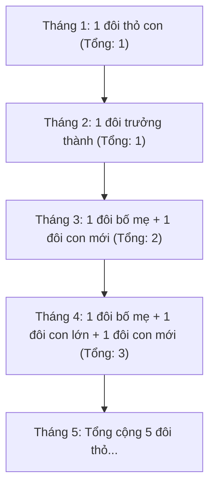

> *"Nếu bạn hỏi một lập trình viên bất kỳ về Fibonacci, câu trả lời 99% sẽ là: 'À, F(n) = F(n-1) + F(n-2) chứ gì, bài tập đệ quy vỡ lòng ai chả biết!'"*

Nhưng nếu chỉ có thế thì Fibonacci đã chẳng thể khiến các nhà toán học và chuyên gia thuật toán mê mẩn suốt 800 năm qua.

Ẩn sau những con số hiền lành $0, 1, 1, 2, 3, 5, 8, 13, 21 \dots$ là cả một kho tàng ma thuật:
- Một nghịch lý hình học biến mất diện tích khiến ai xem cũng ngỡ ngàng.
- Một công thức ước chung lớn nhất đẹp đến rợn ngườ: $\gcd(F_m, F_n) = F_{\gcd(m, n)}$.
- Thuật toán **Fast Doubling** tính $F_{10^{18}}$ chỉ trong vài chục dòng code ngắn ngủn mà không cần viết ma trận rườm rà.

Hôm nay, hãy cùng mình mở khóa toàn bộ những bí mật thú vị nhất của dãy số thần thánh này nhé!

---

## 1. Fibonacci từ con số 0: Khởi đầu của mọi sự tò mò

Năm 1202, nhà toán học người Ý Leonardo Fibonacci đặt ra một bài toán vui về sự sinh sản của đàn thỏ:
- Bạn nuôi một đôi thỏ con (1 đực, 1 cái).
- Sau 1 tháng, đôi thỏ trưởng thành.
- Cứ sau mỗi tháng tiếp theo, mỗi đôi thỏ trưởng thành lại sinh ra một đôi thỏ con mới.
- Thỏ không bao giờ chết!



Quy luật xuất hiện: Số lượng thỏ ở tháng thứ $n$ luôn bằng tổng số thỏ ở tháng liền trước ($n-1$) cộng với số thỏ con mới sinh từ các đôi thỏ đã trưởng thành từ tháng ($n-2$):
$$F_0 = 0, \quad F_1 = 1, \quad F_n = F_{n-1} + F_{n-2} \quad (n \ge 2)$$

Những con số đầu tiên:
$$0, 1, 1, 2, 3, 5, 8, 13, 21, 34, 55, 89, 144, 233, 377, 610, \dots$$

---

## 2. Những tính chất "ảo diệu" khiến bạn sởn gai ốc

### Ma thuật 1: Nghịch lý Cassini ($F_{n-1} F_{n+1} - F_n^2 = (-1)^n$)
Hãy thử lấy một số Fibonacci bất kỳ, bình phương nó lên, rồi so sánh với tích của hai số đứng ngay cạnh nó:
- Chọn số $3$: $1 \times 5 - 3^2 = 5 - 9 = -4$? Không, hai số cạnh $3$ là $2$ và $5$: $2 \times 5 - 3^2 = 10 - 9 = +1$.
- Chọn số $5$: $3 \times 8 - 5^2 = 24 - 25 = -1$.
- Chọn số $8$: $5 \times 13 - 8^2 = 65 - 64 = +1$.
- Chọn số $13$: $8 \times 21 - 13^2 = 168 - 169 = -1$.

Chênh lệch luôn luôn luân phiên đúng bằng **$+1$ hoặc $-1$**!

Đồng nhất thức này chính là nguồn gốc của trò ảo thuật cắt ghép hình chữ nhật nổi tiếng: Cắt một bàn cờ hình vuông $8 \times 8$ (diện tích $64$) ghép lại thành hình chữ nhật kích thước $13 \times 5$ (diện tích $65$). Một ô vuông tự dưng "từ trên trời rơi xuống" ở đâu ra? Bí mật nằm ở chính độ hở siêu nhỏ của đường chéo theo tỉ lệ số Fibonacci này!

### Ma thuật 2: Ước chung lớn nhất thần kỳ
Đây là một trong những định lý số học đẹp nhất từng được phát hiện:
$$\gcd(F_m, F_n) = F_{\gcd(m, n)}$$

*Ước chung lớn nhất của hai số Fibonacci chính là số Fibonacci có chỉ số bằng ước chung lớn nhất của hai chỉ số ban đầu!*

Ví dụ thực tế:
- Tìm $\gcd(F_{12}, F_8)$?
- Ta biết $F_{12} = 144$ và $F_8 = 21$.
- Bình thường bạn phải lấy thước chia $\gcd(144, 21) = 3$.
- Nhưng theo công thức ma thuật: $\gcd(12, 8) = 4 \implies F_4 = 3$. Khớp từng milimet!

### Ma thuật 3: Định lý Zeckendorf & Mã nhị phân Fibonacci
Mọi số nguyên dương đều có thể phân tích thành tổng của các số Fibonacci **không kề nhau** một cách duy nhất!
- $19 = 13 + 5 + 1 = F_7 + F_5 + F_2$
- $40 = 34 + 5 + 1 = F_9 + F_5 + F_2$

Nhờ định lý này, người ta phát minh ra **Mã hóa Fibonacci (Fibonacci Coding)**: Biểu diễn một số thành chuỗi bit $0$ và $1$. Điểm đặc biệt nhất: Ta thêm một bit $1$ vào cuối chuỗi mã, và trong toàn bộ chuỗi **chỉ có duy nhất vị trí kết thúc là xuất hiện hai bit `11` đi liền nhau**! Nhờ đó, người nhận tín hiệu khi đọc luồng dữ liệu chỉ cần thấy hai số $1$ cạnh nhau là biết vừa kết thúc một con số, không sợ bị nhầm lẫn tín hiệu.

---

## 3. Làm sao tính $F_n$ trong lập trình?

### Cách 1: Vòng lặp cơ bản $O(n)$
Ai mới học lập trình cũng viết được cách này bằng cách giữ 2 biến:

```cpp
long long fib_linear(int n) {
    long long a = 0, b = 1;
    for (int i = 0; i < n; i++) {
        long long c = a + b;
        a = b;
        b = c;
    }
    return a;
}
```
Cách này chạy $O(n)$ thời gian và $O(1)$ bộ nhớ. Quá tuyệt vời nếu $n \le 10^7$. Nhưng nếu $n = 10^{18}$ thì sao? Vòng lặp sẽ chạy mất cả trăm năm!

---

### Cách 2: Nhân ma trận nhị phân $O(\log n)$
Chuyển công thức truy hồi sang dạng ma trận $2 \times 2$:
$$\begin{pmatrix} 1 & 1 \\ 1 & 0 \end{pmatrix} \begin{pmatrix} F_n \\ F_{n-1} \end{pmatrix} = \begin{pmatrix} F_{n+1} \\ F_n \end{pmatrix}$$

Suy ra:
$$\begin{pmatrix} 1 & 1 \\ 1 & 0 \end{pmatrix}^n = \begin{pmatrix} F_{n+1} & F_n \\ F_n & F_{n-1} \end{pmatrix}$$

Dùng thuật toán lũy thừa nhị phân (Binary Exponentiation), ta tính lũy thừa bậc $n$ của ma trận chỉ mất **$O(\log n)$**!

---

### Cách 3: Fast Doubling Method - Đỉnh cao tối giản!

Nhân ma trận viết khá dài (cần tạo struct ma trận, nạp chồng toán tử `*`). Có cách nào cũng chạy $O(\log n)$ mà code chỉ vẻn vẹn vài dòng không?

Có! Đó chính là phương pháp **Fast Doubling (Nhân đôi nhanh)**. 

Bằng cách khai triển bình phương của ma trận ở bước $n = 2k$, ta rút ra hai công thức nhảy cóc siêu gọn:
$$\begin{cases} F_{2k} = F_k \cdot (2F_{k+1} - F_k) \\ F_{2k+1} = F_{k+1}^2 + F_k^2 \end{cases}$$

### Cài đặt C++ siêu thanh lịch (kèm Modulo):

```cpp
#include <iostream>
#include <utility>

const long long MOD = 1e9 + 7;

// Trả về cặp {F(n), F(n + 1)} theo modulo MOD
std::pair<long long, long long> fib_fast_doubling(long long n) {
    if (n == 0) return {0, 1};
    
    // Gọi đệ quy chia đôi chỉ số
    auto [fk, fk1] = fib_fast_doubling(n >> 1);
    
    // Áp dụng công thức Fast Doubling
    long long f2k = (fk * ((2 * fk1 - fk + MOD) % MOD)) % MOD;
    long long f2k1 = (fk * fk % MOD + fk1 * fk1 % MOD) % MOD;
    
    if (n & 1) {
        // Nếu n là số lẻ: F(2k + 1) và F(2k + 2) = F(2k) + F(2k + 1)
        return {f2k1, (f2k + f2k1) % MOD};
    } else {
        // Nếu n là số chẵn: F(2k) và F(2k + 1)
        return {f2k, f2k1};
    }
}

long long get_fib(long long n) {
    return fib_fast_doubling(n).first;
}
```

Với $n = 10^{18}$, hàm trên chỉ gọi đệ quy đúng khoảng **$60$ lần** và trả về kết quả trong chưa đầy **$0.00001$ giây**!

---

## 4. Chu kỳ Pisano: Dãy số Fibonacci có lặp lại không?

Khi lấy dãy Fibonacci chia dư cho một số nguyên $p$ bất kỳ ($F_n \bmod p$), dãy số dư này **chắc chắn sẽ tuần hoàn lặp lại từ đầu**!

Chu kỳ lặp lại đó được gọi là **Chu kỳ Pisano** (ký hiệu là $\pi(p)$).
- Với $p = 2$: Dãy số dư là `0, 1, 1, 0, 1, 1...` $\implies$ Chu kỳ bằng $3$.
- Với $p = 10$: Chữ số tận cùng của các số Fibonacci lặp lại sau mỗi chu kỳ đúng bằng $60$.

Nhờ chu kỳ Pisano, nếu cần tính số Fibonacci thứ $10^{100}$ (với số mũ cực lớn không chứa vừa biến 64-bit), ta chỉ cần tìm chu kỳ $\pi(p)$ rồi lấy số mũ modulo cho chu kỳ đó trước khi tính!

---

## 5. Bảng tổng kết các phương pháp tính $F_n$

| Phương pháp | Độ phức tạp thời gian | Bộ nhớ phụ | Nhận xét thực chiến |
| :--- | :--- | :--- | :--- |
| **Đệ quy ngây thơ** | $O(2^n)$ | $O(n)$ | Tệ nhất, $n = 45$ đã đứng hình máy tính. |
| **Vòng lặp tuyến tính** | $O(n)$ | $O(1)$ | Đơn giản, hoàn hảo cho $n \le 10^7$. |
| **Công thức Binet** | $O(1)$ | $O(1)$ | Bị sai số trôi dấu phẩy động (`double`), không áp dụng được modulo. |
| **Nhân ma trận** | $O(\log n)$ | $O(1)$ | Chuẩn mực, dễ mở rộng cho mọi dãy số quy hoạch động khác. |
| **Fast Doubling** | $O(\log n)$ | $O(\log n)$ | **Khuyên dùng nhất**: Code ngắn nhất, chạy nhanh hơn nhân ma trận do ít phép tính hơn! |

---

## 6. Bài tập thực hành để "lên trình"

Dưới đây là các bài tập chọn lọc giúp bạn kiểm tra ngay những ma thuật vừa học:

1. [HackerRank - Is Fibo](https://www.hackerrank.com/challenges/is-fibo/problem): Nhập môn nhận biết một số có phải là số Fibonacci không.
2. [Codeforces 199A - Hexadecimal's theorem](https://codeforces.com/problemset/problem/199/A): Một bài toán tư duy thú vị về tổng các số Fibonacci.
3. [SPOJ - Fibonacci Sum](http://www.spoj.com/problems/FIBOSUM/): Tính tổng $F_N + F_{N+1} + \dots + F_M \pmod{10^9+7}$.
4. [DMOJ - Fibonacci Sequence (Harder)](https://dmoj.ca/problem/fibonacci2): Thử thách tính Fibonacci với $N$ lên tới $10^{19}$ bằng Fast Doubling.

---

## Lời kết

Giờ thì mỗi khi ai đó nhắc tới Fibonacci, bạn sẽ không còn chỉ nghĩ về một bài đệ quy buồn ngủ nữa. Dãy Fibonacci là cầu nối tuyệt đẹp giữa tự nhiên, hình học và thuật toán hiện đại. Chúc bạn code thật vui và chinh phục trọn vẹn những bài toán số học sắp tới!
