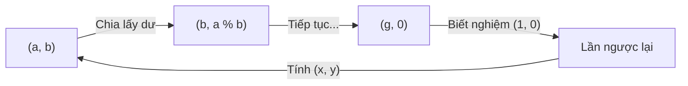

> *"Ở bài trước, chúng mình đã biết Euclid tìm ước chung lớn nhất $\gcd(a, b)$ nhanh như chớp. Nhưng chuyện gì xảy ra nếu bài toán đòi hỏi nhiều hơn thế: Tìm hai số nguyên $x$ và $y$ sao cho $a \cdot x + b \cdot y = \gcd(a, b)$?"*

Nếu bạn vừa đọc đề bài mà thấy xuất hiện những cụm từ như *"Đồng nhất thức Bézout"*, *"Phương trình Diophantine tuyến tính"* hay *"Hệ số nguyên âm dương"* và bắt đầu thấy tim đập nhanh, chân tay bủn rủn — thì hãy thở sâu một hơi nào!

Đừng để những cái tên bác học dọa bạn. Bản chất của thuật toán Euclid mở rộng (Extended Euclidean Algorithm) thực ra chỉ là một **bước quay lui (backtracking)** cực kỳ tự nhiên khi ta giải bài toán đong nước quen thuộc từ hồi tiểu học mà thôi.

---

## 1. Trò chơi đong nước kinh điển

Bạn có nhớ câu đố này không?
> *"Bạn có hai chiếc ca: một ca dung tích **$5\text{ lít}$**, một ca dung tích **$3\text{ lít}$**. Bên cạnh là một vòi nước chảy vô tận. Làm sao để bạn đong được chính xác **$1\text{ lít}$** nước?"*

Cách làm thực tế:
1. Múc đầy ca $5$ lít ($+5$).
2. Rót từ ca $5$ lít sang ca $3$ lít cho đến khi ca $3$ lít đầy tràn ($ - 3$).
3. Trong ca $5$ lít lúc này còn đúng: $5 - 3 = 2$ lít!
4. Đổ hết ca $3$ lít đi. Rót $2$ lít từ ca lớn sang ca nhỏ.
5. Múc đầy lại ca $5$ lít ($+5$).
6. Rót tiếp từ ca $5$ lít sang ca $3$ lít (lúc này ca $3$ lít đang có sẵn $2$ lít nên chỉ cần rót thêm $1$ lít nữa là đầy) ($ - 3$).
7. Lượng nước trào ra hoặc rút đi sau các thao tác đó giúp bạn đo được chính xác $1$ lít!

Nhìn dưới góc độ toán học:
$$5 \times 2 + 3 \times (-3) = 10 - 9 = 1$$

Ta vừa múc $2$ lần ca $5$ lít ($x = 2$) và đổ bỏ $3$ lần ca $3$ lít ($y = -3$) để thu được đúng $1$ lít!

Con số $1$ đó chính là $\gcd(5, 3)$. Và cặp số $(x, y) = (2, -3)$ chính là thứ mà **Thuật toán Euclid mở rộng** sinh ra để đi tìm!

---

## 2. Đồng nhất thức Bézout (Bézout's Identity) là gì?

Nhà toán học người Pháp Étienne Bézout đã chứng minh một định lý cực kỳ đẹp đẽ:
> *Với mọi cặp số nguyên $a$ và $b$, ta luôn luôn tìm được ít nhất một cặp số nguyên $x$ và $y$ thỏa mãn:*
> $$a \cdot x + b \cdot y = \gcd(a, b)$$

Ví dụ:
- $\gcd(55, 80) = 5$. Ta luôn tìm được: $55 \cdot 3 + 80 \cdot (-2) = 165 - 160 = 5$ (ở đây $x = 3, y = -2$).
- $\gcd(6, 4) = 2$. Ta có ngay: $6 \cdot 1 + 4 \cdot (-1) = 2$ (ở đây $x = 1, y = -1$).

*Lưu ý:* $x$ và $y$ có thể là số âm, số $0$ hoặc số dương, và có thể có vô số cặp $(x, y)$ thỏa mãn. Thuật toán của chúng ta chỉ cần tìm ra **một cặp** đại diện là đủ!

---

## 3. Ý tưởng thuật toán: Đi xuôi rồi đi ngược

Hãy nhớ lại thuật toán Euclid cơ bản: Ta liên tục lấy $a \bmod b$ cho đến khi $b = 0$.



### Bước 1: Khi chạm đáy (Trường hợp dừng)
Khi $b = 0$, thuật toán dừng lại và ước chung lớn nhất chính là $a$ (gọi là $g$).

Lúc này phương trình trở thành:
$$a \cdot x + 0 \cdot y = a$$

Dễ thấy ngay một nghiệm cực kỳ hiển nhiên:
$$\begin{cases} x = 1 \\ y = 0 \end{cases}$$
*(Bởi vì $a \cdot 1 + 0 \cdot 0 = a$, chuẩn chưa nào!)*

### Bước 2: Từ đáy ngoi lên (Lần ngược lại từng bước)
Giả sử ta vừa đệ quy và đã biết nghiệm $(x_1, y_1)$ của bài toán con ở tầng dưới $(b, a \bmod b)$:
$$b \cdot x_1 + (a \bmod b) \cdot y_1 = g$$

Bây giờ ta cần tìm cặp $(x, y)$ cho bài toán ở tầng trên $(a, b)$:
$$a \cdot x + b \cdot y = g$$

Bí quyết nằm ở phép biến đổi số học lớp 3: **Số dư = Số bị chia - (Thương $\times$ Số chia)**:
$$a \bmod b = a - \left\lfloor \frac{a}{b} \right\rfloor \cdot b$$

Thay biểu thức này vào phương trình tầng dưới:
$$g = b \cdot x_1 + \left(a - \left\lfloor \frac{a}{b} \right\rfloor \cdot b\right) \cdot y_1$$

Nhân tung ngoặc ra và gom $a$ với $b$ lại:
$$g = a \cdot y_1 + b \cdot \left(x_1 - y_1 \cdot \left\lfloor \frac{a}{b} \right\rfloor\right)$$

So sánh với phương trình $a \cdot x + b \cdot y = g$, ta thấy ngay:
$$\begin{cases} x = y_1 \\ y = x_1 - y_1 \cdot \left\lfloor \frac{a}{b} \right\rfloor \end{cases}$$

Chỉ đơn giản như vậy thôi! Mỗi khi bước ra khỏi một tầng đệ quy, ta cập nhật $x$ và $y$ theo đúng 2 dòng công thức này.

---

## 4. Cài đặt C++

### Cách 1: Đệ quy truyền tham chiếu (Dễ nhớ nhất)

Ta truyền $x$ và $y$ vào hàm dưới dạng tham chiếu (`&`) để sau khi đệ quy tính xong ở tầng dưới, ta gán ngược kết quả lên trên:

```cpp
// Hàm trả về gcd(a, b) và gán nghiệm vào 2 biến tham chiếu x, y
long long extgcd(long long a, long long b, long long &x, long long &y) {
    if (b == 0) {
        x = 1;
        y = 0;
        return a;
    }
    long long x1, y1;
    long long d = extgcd(b, a % b, x1, y1);
    
    // Cập nhật nghiệm cho tầng hiện tại
    x = y1;
    y = x1 - y1 * (a / b);
    
    return d;
}
```

*Một điểm tuyệt vời:* Cài đặt này hoạt động chính xác cho cả số âm lẫn số dương mà bạn không cần phải viết thêm điều kiện if-else nào cả!

---

### Cách 2: Vòng lặp không đệ quy (Iterative Version)

Nếu bạn muốn tối ưu tốc độ tối đa cho các bài tập Competitive Programming khắt khe, ta có thể viết bằng vòng lặp `while`.

Ý tưởng là duy trì hai hệ thức bất biến (invariants) qua mỗi vòng lặp:
$$x \cdot a + y \cdot b = a_1$$
$$x_1 \cdot a + y_1 \cdot b = b_1$$

Code C++ ngắn gọn dùng `std::tie`:

```cpp
#include <tuple>

long long extgcd_iterative(long long a, long long b, long long &x, long long &y) {
    x = 1; y = 0;
    long long x1 = 0, y1 = 1;
    long long a1 = a, b1 = b;
    
    while (b1) {
        long long q = a1 / b1;
        std::tie(x, x1) = std::make_pair(x1, x - q * x1);
        std::tie(y, y1) = std::make_pair(y1, y - q * y1);
        std::tie(a1, b1) = std::make_pair(b1, a1 - q * b1);
    }
    return a1;
}
```

---

## 5. Thuật toán này dùng để làm gì trong thực tế?

Đừng nghĩ thuật toán này chỉ để đi thi toán trên giấy. Trong lập trình thi đấu và mật mã học (như mã hóa RSA), nó là chìa khóa vạn năng cho hai bài toán lớn:

### 1. Giải phương trình nghiệm nguyên (Linear Diophantine Equation)
Đề bài thường yêu cầu: Cho $a, b, c$, tìm nghiệm nguyên của phương trình:
$$a \cdot x + b \cdot y = c$$

- **Điều kiện có nghiệm:** Phương trình chỉ có nghiệm nguyên khi và chỉ khi $c$ chia hết cho $\gcd(a, b)$. Nếu không chia hết $\to$ vô nghiệm!
- **Tìm nghiệm:** Ta dùng Euclid mở rộng tìm nghiệm $(x_0, y_0)$ của $a \cdot x_0 + b \cdot y_0 = \gcd(a, b)$. Sau đó chỉ cần nhân cả hai vế với tỉ lệ $\frac{c}{\gcd(a, b)}$:
  $$x = x_0 \cdot \frac{c}{\gcd(a, b)}, \quad y = y_0 \cdot \frac{c}{\gcd(a, b)}$$

### 2. Tìm nghịch đảo Modulo (Modular Inverse)
Khi làm các bài toán tổ hợp cần chia modulo: $\frac{A}{B} \pmod m$. Ta không thể lấy phép chia thông thường rồi `% m` được, mà phải nhân với **nghịch đảo modulo** của $B$.

Nghịch đảo modulo của $a$ theo modulo $m$ là số $x$ sao cho:
$$a \cdot x \equiv 1 \pmod m \iff a \cdot x + m \cdot y = 1$$

Bạn thấy quen chưa? Đây chính là phương trình Bézout với hai số $a$ và $m$ khi $\gcd(a, m) = 1$! 
Chạy Euclid mở rộng tìm $x$, rồi lấy `(x % m + m) % m` là ra ngay nghịch đảo modulo.

---

## 6. Bảng tổng kết

| Thuật toán | Mục tiêu | Kết quả trả về | Độ phức tạp |
| :--- | :--- | :--- | :--- |
| **Euclid cơ bản** | Chỉ tìm ước chung lớn nhất | $\gcd(a, b)$ | $O(\log \min(a, b))$ |
| **Euclid mở rộng** | Tìm GCD và cặp hệ số Bézout | $\gcd(a, b)$ và cặp $(x, y)$ sao cho $a \cdot x + b \cdot y = \gcd$ | $O(\log \min(a, b))$ |

---

## Lời nhắn nhủ

Toán học không sinh ra từ những công thức trên trời rơi xuống. Nó bắt đầu từ một bài toán rất đỗi đời thường: *Làm sao đong được nước? Làm sao chia đều đồ vật?*

Euclid mở rộng chỉ là người dẫn đường giúp bạn ghi chép lại hành trình đong nước đó để khi chạm đáy thì lần ngược lại điểm xuất phát. Hãy thử tự tay lấy bút gạch ra giấy một ví dụ nhỏ như cặp $(6, 4)$ hay $(55, 80)$, bạn sẽ thấy từng con số nhảy múa khớp vào nhau một cách kỳ diệu!
