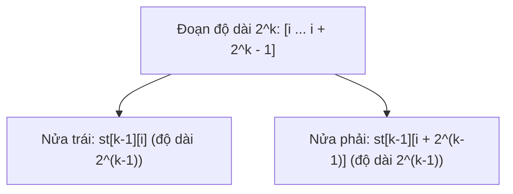

> *"Tưởng tượng đề bài cho bạn một dãy số dài dằng dặc $10^6$ phần tử, mảng này cố định không hề thay đổi. Sau đó, nó dội vào bạn $10^6$ câu hỏi liên tiếp: 'Từ vị trí L đến vị trí R, số nhỏ nhất là bao nhiêu?'"*

Nếu bạn dùng vòng lặp duyệt từng đoạn: $O(N)$ cho mỗi câu hỏi $\to$ $10^6 \times 10^6 = 10^{12}$ phép tính, chạy mất cả ngày.  
Nếu bạn dùng Cây phân đoạn (Segment Tree): $O(\log N)$ cho mỗi câu hỏi $\to$ Chạy mất khoảng $0.5$ giây, code dài $60$ dòng và đệ quy khá nặng nề.

Nhưng nếu mình nói với bạn rằng: Có một cấu trúc dữ liệu chỉ cần tiền xử lý trong vài chục dòng code ngắn gọn, và sau đó **trả lời mỗi câu hỏi tìm Min/Max chỉ bằng ĐÚNG MỘT PHÉP TÍNH $O(1)$** thì bạn có tin không?

Đó chính là **Sparse Table (Bảng thưa)** — thứ vũ khí bí mật mà mọi tuyển thủ Competitive Programming đều thủ sẵn trong túi!

---

## 1. Trực giác cốt lõi: Ma thuật của lũy thừa số 2

Tại sao Sparse Table lại làm được điều kỳ diệu đó? Tất cả bắt nguồn từ một sự thật số học quen thuộc:

> **Mọi số nguyên dương đều có thể phân tích thành tổng các lũy thừa của 2 (Hệ nhị phân).**

Ví dụ:
$$13 = 8 + 4 + 1 = 2^3 + 2^2 + 2^0$$

Áp dụng điều này vào các đoạn con trong mảng: Mọi đoạn con có độ dài bất kỳ đều có thể ghép lại từ các đoạn con nhỏ hơn có độ dài là lũy thừa của $2$ ($1, 2, 4, 8, 16, 32 \dots$).

Thay vì tính trước kết quả cho mọi cặp $[L, R]$ khả dĩ (tốn $O(N^2)$ bộ nhớ - điều bất khả thi khi $N = 10^5$), Sparse Table chỉ tính trước câu trả lời cho các đoạn có **độ dài là lũy thừa của 2**:
- Các đoạn độ dài $2^0 = 1$: $[i, i]$
- Các đoạn độ dài $2^1 = 2$: $[i, i + 1]$
- Các đoạn độ dài $2^2 = 4$: $[i, i + 3]$
- Các đoạn độ dài $2^3 = 8$: $[i, i + 7]$

Vì mỗi vị trí $i$ chỉ có tối đa khoảng $\log_2 N \approx 20$ đoạn độ dài lũy thừa của 2, tổng bộ nhớ cần dùng chỉ là:
$$N \times \log_2 N$$
Với $N = 10^5$, $N \log_2 N \approx 1.7 \cdot 10^6$ ô nhớ — cực kỳ nhỏ gọn và vừa khít RAM!

---

## 2. Tiền xử lý (Precomputation) bằng Quy hoạch động

Ta định nghĩa một mảng hai chiều `st[k][i]`:
- **Ý nghĩa:** `st[k][i]` lưu giá trị nhỏ nhất của đoạn bắt đầu từ vị trí $i$, có độ dài đúng bằng **$2^k$** (tức là đoạn $[i, i + 2^k - 1]$).

### Công thức ghép đôi siêu dễ hiểu:
Một đoạn độ dài $2^k$ có thể bẻ đôi thành **hai đoạn nhỏ bằng nhau**, mỗi đoạn có độ dài đúng bằng $2^{k-1}$:
- Nửa bên trái: Bắt đầu từ $i$, độ dài $2^{k-1}$ $\implies$ `st[k - 1][i]`.
- Nửa bên phải: Bắt đầu từ vị trí $(i + 2^{k-1})$, độ dài $2^{k-1}$ $\implies$ `st[k - 1][i + (1 << (k - 1))]`.



Giá trị nhỏ nhất của cả đoạn to chính là giá trị nhỏ hơn giữa hai nửa:
$$\text{st}[k][i] = \min(\text{st}[k - 1][i], \;\text{st}[k - 1][i + 2^{k - 1}])$$

### Cài đặt C++ phần tiền xử lý:
```cpp
const int MAXN = 200005;
const int K = 20; // Vì 2^20 > 10^6
int st[K + 1][MAXN];

void build_sparse_table(const std::vector<int>& a) {
    int n = a.size();
    // Bước cơ sở: Các đoạn độ dài 2^0 = 1 chính là từng phần tử a[i]
    for (int i = 0; i < n; i++) {
        st[0][i] = a[i];
    }

    // Quy hoạch động tính các đoạn độ dài 2^1, 2^2, 2^3...
    for (int k = 1; k <= K; k++) {
        for (int i = 0; i + (1 << k) <= n; i++) {
            st[k][i] = std::min(st[k - 1][i], st[k - 1][i + (1 << (k - 1))]);
        }
    }
}
```
*Thời gian tiền xử lý:* $O(N \log N)$ — chạy trong chưa đầy $0.05$ giây!

---

## 3. Bí thuật trả lời truy vấn RMQ trong ĐÚNG $O(1)$

Đây là phần "ảo diệu" nhất của bài viết. Hãy chú ý nhé!

Giả sử ta cần tìm giá trị nhỏ nhất trên đoạn $[L, R]$. Độ dài đoạn này là $\text{len} = R - L + 1$.  
Ta tìm lũy thừa của $2$ lớn nhất mà vẫn **nhỏ hơn hoặc bằng** $\text{len}$:
$$k = \lfloor \log_2(\text{len}) \rfloor$$
Ví dụ: Đoạn $[1, 6]$ có độ dài là $6$. Số lũy thừa của $2$ lớn nhất $\le 6$ là $2^2 = 4$ ($k = 2$).

### Tính chất lũy đẳng (Idempotence) - Chìa khóa vàng!
Khác với phép cộng (nếu bạn cộng một số hai lần thì kết quả sẽ bị sai), phép toán $\min$, $\max$, $\gcd$ có một đặc tính tuyệt vời gọi là **lũy đẳng**:
$$\min(x, x) = x, \quad \gcd(x, x) = x$$
Nghĩa là: **Hai đoạn con có CHỒNG LÊN NHAU (trùng lặp một phần) thì kết quả tìm Min vẫn đúng 100%!**

### Ý tưởng 2 tấm ván:
Thay vì phải chia $[L, R]$ thành nhiều đoạn rời rạc phức tạp, ta chỉ cần **đặt 2 tấm ván độ dài $2^k$ đè lên nhau**:
- Tấm ván 1: Bắt đầu từ đầu mút bên trái $L$ dài sang phải $2^k$: $[L, L + 2^k - 1]$.
- Tấm ván 2: Bắt đầu từ đầu mút bên phải $R$ thụt về trái $2^k$: $[R - 2^k + 1, R]$.

```
Đoạn cần truy vấn [L, R]:
|-----------------------------------------------|
[===== Tấm ván 1 (độ dài 2^k) =====]
               [===== Tấm ván 2 (độ dài 2^k) =====]
               ^^^^^^^^^^^^^^^^
               Phần chồng lấn (không hề ảnh hưởng đến Min!)
```

Vì $2^k \ge \text{len} / 2$, nên hai tấm ván này **chắc chắn sẽ phủ kín toàn bộ đoạn $[L, R]$** mà không chừa ra bất kỳ phần tử nào!

Vậy kết quả Min của đoạn $[L, R]$ chỉ là:
$$\min(\text{st}[k][L], \;\text{st}[k][R - 2^k + 1])$$

Đúng **1 dòng code**, đúng **1 phép tính**, thời gian chạy là **$O(1)$** tuyệt đối!

---

## 4. Tính $\log_2$ siêu tốc

Để làm được phép truy vấn trong $O(1)$, ta cần tính $k = \lfloor \log_2(\text{len}) \rfloor$ tức thời.

### Cách 1: Dùng hàm có sẵn trong C++ (Nhanh nhất)
Từ C++20, bạn có thể dùng `std::bit_width(len) - 1`.  
Hoặc trong GCC: `31 - __builtin_clz(len)` (đếm số bit 0 ở đầu) hoặc `std::__lg(len)`.

### Cách 2: Bảng tiền xử lý mảng `lg[]`
```cpp
int lg[MAXN];
void init_log() {
    lg[1] = 0;
    for (int i = 2; i < MAXN; i++) {
        lg[i] = lg[i / 2] + 1;
    }
}
```

---

## 5. Code C++ mẫu hoàn chỉnh sẵn sàng dùng trong thi đấu

Dưới đây là một template struct `SparseTable` cực kỳ sạch sẽ, bạn có thể copy vào bài làm:

```cpp
#include <iostream>
#include <vector>
#include <algorithm>

struct SparseTable {
    int n, K;
    std::vector<std::vector<int>> st;
    std::vector<int> lg;

    SparseTable(const std::vector<int>& a) {
        n = a.size();
        K = 0;
        while ((1 << K) <= n) K++;

        st.assign(K + 1, std::vector<int>(n));
        lg.assign(n + 1, 0);

        for (int i = 2; i <= n; i++) lg[i] = lg[i / 2] + 1;

        for (int i = 0; i < n; i++) st[0][i] = a[i];

        for (int k = 1; k <= K; k++) {
            for (int i = 0; i + (1 << k) <= n; i++) {
                st[k][i] = std::min(st[k - 1][i], st[k - 1][i + (1 << (k - 1))]);
            }
        }
    }

    // Truy vấn RMQ trên đoạn [L, R] (0-based) trong O(1)
    int query(int L, int R) {
        int k = lg[R - L + 1];
        return std::min(st[k][L], st[k][R - (1 << k) + 1]);
    }
};
```

---

## 6. So sánh: Khi nào NÊN và KHÔNG NÊN dùng Sparse Table?

| Tiêu chí | Sparse Table | Segment Tree | Fenwick Tree |
| :--- | :--- | :--- | :--- |
| **Tiền xử lý (Build)** | $O(N \log N)$ | $O(N)$ | $O(N)$ |
| **Truy vấn Min/Max (RMQ)** | **$O(1)$ siêu tốc** | $O(\log N)$ | Khó hỗ trợ RMQ |
| **Cập nhật giá trị (Update)** | **KHÔNG HỖ TRỢ** (Mảng phải tĩnh) | $O(\log N)$ | $O(\log N)$ |
| **Độ dài code** | Ngắn (~25 dòng) | Dài (~60 dòng) | Rất ngắn (~20 dòng) |

> **Nguyên tắc vàng:**  
> - Nếu mảng **CỐ ĐỊNH** (không có thao tác sửa giá trị phần tử) và cần hỏi Min/Max/GCD hàng triệu lần $\to$ **Dùng ngay Sparse Table**!  
> - Nếu có thao tác cập nhật giá trị giữa chừng $\to$ **Bắt buộc dùng Segment Tree**.

---

## 7. Bài tập thực hành có link trực tiếp

Hãy thử nộp các bài sau để cảm nhận tốc độ $O(1)$ chém ngọt qua mọi giới hạn thời gian:

1. [CSES - Static Range Minimum Queries](https://cses.fi/problemset/task/1647): Bài toán chuẩn mực nhất để test Sparse Table.
2. [SPOJ - RMQSQ](http://www.spoj.com/problems/RMQSQ/): Truy vấn giá trị nhỏ nhất trên đoạn cổ điển.
3. [Codeforces 1547F - Array Stabilization (GCD version)](http://codeforces.com/problemset/problem/1547/F): Ứng dụng Sparse Table kết hợp tìm kiếm nhị phân với hàm $\gcd$ trên đoạn.
4. [Codeforces 475D - CGCDSSQ](http://codeforces.com/contest/475/problem/D): Bài toán đếm số đoạn con có GCD bằng $X$ cực hay.

---

## Lời kết

Sparse Table là một minh chứng tuyệt vời cho vẻ đẹp của tư duy nhị phân trong khoa học máy tính: Chia nhỏ vấn đề theo lũy thừa của 2, và tận dụng tính chất toán học (lũy đẳng) để giải quyết truy vấn trong tích tắc. Chúc các bạn áp dụng thành công và đạt thật nhiều điểm xanh trong contest tiếp theo!
